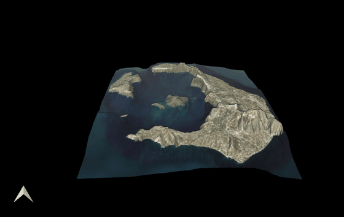
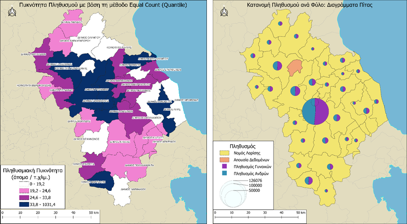
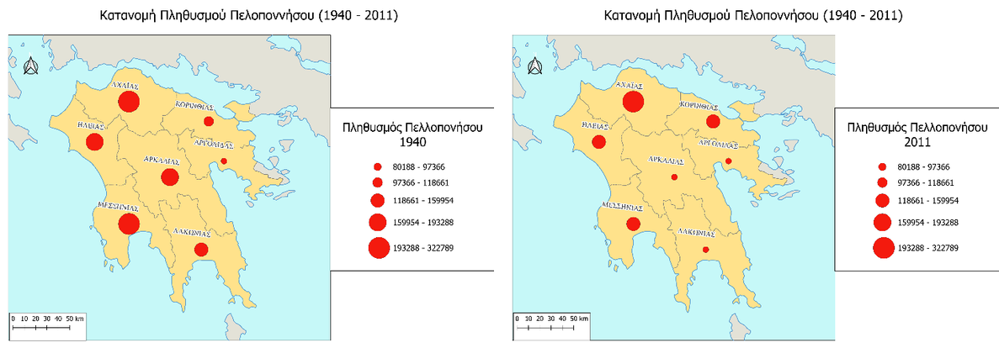
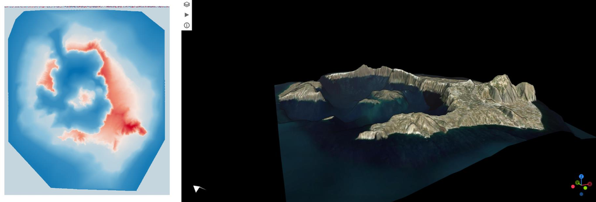
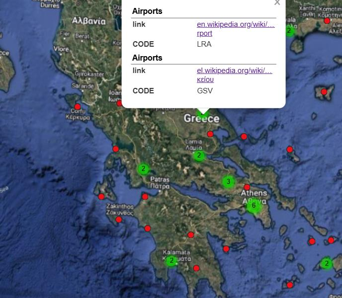
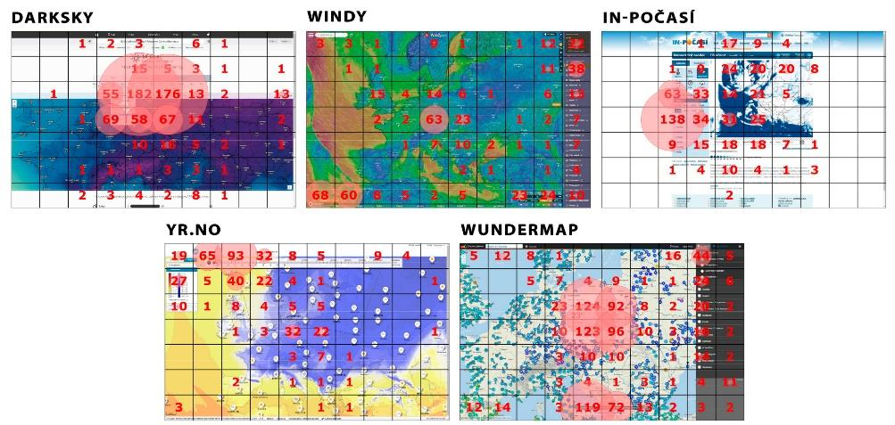

# Web GIS, Interactive Geovisualization & Cartographic Usability

Static thematic maps, a small interactive web platform (animated map, 3D WebGL terrain and a web map) and a literature review on the usability of web maps, produced for the postgraduate course *Cartographic Visualization* (MSc in Artificial Intelligence & Visual Computing).

📄 **[Read the Full Technical Report & Presentation (PDF)](./Cartographic_Visualization_Web_GIS_Report.pdf)**

🌐 **Live demo:** [https://agathiba.github.io/web-gis-cartographic-visualization-usability/](https://agathiba.github.io/web-gis-cartographic-visualization-usability/)

| Map | Link |
| :--- | :--- |
| Animated population map of the Peloponnese (1940–2011) | [Open](https://agathiba.github.io/web-gis-cartographic-visualization-usability/) |
| 3D map of Santorini (desktop) | [Open](https://agathiba.github.io/web-gis-cartographic-visualization-usability/santorini/index.html) |
| 3D map of Santorini (mobile, with AR mode) | [Open](https://agathiba.github.io/web-gis-cartographic-visualization-usability/santorini/mobile.html) |
| Airports of Greece (interactive web map) | [Open](https://agathiba.github.io/web-gis-cartographic-visualization-usability/airports/index.html) |

<p align="center">
  <a href="https://agathiba.github.io/web-gis-cartographic-visualization-usability/santorini/index.html"></a>
  <br><em>3D map of Santorini (Qgis2threejs) – click to open the interactive version</em>
</p>

---

## 📌 Project Modules

### 1. Static Cartographic Modeling & Spatial Distribution Analysis (QGIS)
* **Objective:** Methodological exploration of thematic cartography, measurement scales, and visual variables across the administrative units of Larissa Prefecture, Greece.
* **Methodology & Techniques:**
  * **Attribute & Spatial Classification:** Structured administrative vector layers; classified attributes across Nominal, Ordinal, Interval, and Ratio measurement scales.
  * **Population density** was derived with the QGIS field calculator (population / area), and the measurement scale of each attribute was characterised.
  * **Statistical Breakdown (Histograms):** Compared **Natural Breaks (Jenks)** and **Quantile** classification (5 classes) on the skewed density distribution, using the histogram to avoid visual distortion.
  * **Advanced Representation Methods:** Produced Choropleth maps, graduated point distributions, proportional pie charts (gender breakdown), and continuous area-distortion **Contiguous Cartograms** using the `cartogram3` algorithm.

<p align="center">
  
  <br><em>Choropleth population density (left) and proportional pie-chart symbols (right)</em>
</p>

<p align="center">
  
  <br><em>Frames from the animated population map of the Peloponnese, 1940 and 2011</em>
</p>

---

### 2. Interactive Web GIS & 3D Geovisualization Platform
* **Objective:** Development of an integrated web platform hosting interactive, temporal, and three-dimensional geospatial assets.
* **Interactive Modules:**
  * **Spatiotemporal Population Animation (Peloponnese 1940–2011):** A Python script ([`scripts/quantile_breaks.py`](./scripts/quantile_breaks.py)) uses `numpy.quantile` on the pooled values of all census years to derive five common class limits, so that the graduated symbols are comparable across years. One map was exported per census year and the frames were cross-faded in GIMP into an animated GIF (the intermediate frames are visual blends, not interpolated data).
  * **3D Surface & Bathymetric Visualization (Santorini Island):** Merged the island DEM with the surrounding bathymetry raster into one elevation and depth model and exported interactive WebGL scenes (desktop and mobile versions) with `Qgis2threejs`, with several basemaps added through QuickMapServices (Esri, Bing, Google, OpenStreetMap).
  * **Interactive Web Map of Greek Airports:** Airport points with manually added attributes (website, IATA/ICAO code; some left blank where no information was available, e.g. military airports), exported with `qgis2web` with point clustering, a search bar and attribute popups.
  * **Landing page:** A static HTML page built with KompoZer and GIMP that gathers the four maps.

<p align="center">
  
  <br><em>Santorini: bathymetry (left) and 3D terrain visualization from DEM data (right)</em>
</p>

<p align="center">
  
  <br><em>Multimedia web map of Greek airports with linked metadata</em>
</p>

> **Note on basemaps:** the Santorini scenes use Google and Bing tiles through QuickMapServices. For a public demo, check the terms of use of these services, or switch to OpenStreetMap or Esri imagery with attribution.

---

### 3. Literature Review: Usability and Eye-Tracking of Web Maps
* **Objective:** A critical review of the article *"Eye-tracking Evaluation of Weather Web Maps"* (Popelka et al.) together with related literature on web-map usability. The eye-tracking study itself was carried out by the authors of the article; this module is a review, not an experiment.
* **Scope of the review:**
  * **Study design (as reported by the authors):** 34 participants (16 novices, 18 experts), an SMI RED 250 eye tracker (250 Hz) and think-aloud interviews; fixations, scanpaths and task duration on five weather web maps (*Windy*, *DarkSky*, *In-Počasí*, *YR.no*, *Wundermap*).
  * **Findings summarised:** In-Počasí was the most user-friendly map, Windy was cluttered, Wundermap suffered from slow loading and poor organisation; legend clarity and interface overload were the main problems.
  * **Literature review and gaps:** Related work on usability, eye-tracking and design principles (e.g. Harrower, Nivala, Roth, MacEachren, Brewer, Peterson), and gaps such as demographic diversity, longitudinal studies and adaptive maps.
  * **Recommendations discussed:** simpler layouts, clearer legends, faster loading, customisation for novices and experts.

<p align="center">
  
  <br><em>Eye-tracking heatmaps on five weather web maps (Dark Sky, Windy, In-Počasí, Yr.no, Wundermap). Figure from the reviewed article by Popelka et al., shown for illustration; all rights belong to the original authors.</em>
</p>

---

## 🛠️ Tech Stack & Software
* **GIS & Web Mapping:** QGIS (`qgis2web`, `Qgis2threejs`, `cartogram3`, `QuickMapServices`), Leaflet / OpenLayers, WebGL
* **Programming & Data Analysis:** Python (NumPy, quantile distributions), HTML5/CSS
* **Graphics & Authoring:** GIMP, KompoZer
* **Domain Topics:** Thematic Cartography, 3D Bathymetry/DEM Merging, Spatiotemporal Visualization, Web-Map Usability (literature review)

---

## 📁 Repository Structure

```
├── docs/                         # Website, published with GitHub Pages
│   ├── index.html                # Landing page with all four maps
│   ├── peloponnese_animation.gif # Animated population map (1940–2011)
│   ├── santorini/                # 3D WebGL scene exported with Qgis2threejs
│   │   ├── index.html            #   desktop version
│   │   └── mobile.html           #   mobile version (device orientation & AR mode)
│   └── airports/                 # Interactive web map exported with qgis2web
├── scripts/
│   └── quantile_breaks.py        # Common quantile class limits for the animation
├── images/                       # Figures used in this README
└── Cartographic_Visualization_Web_GIS_Report.pdf
```

## ▶️ Run Locally

The maps load their data with JavaScript, so open them through a local web server rather than by double-clicking the files:

```bash
cd docs
python -m http.server 8000
# then open http://localhost:8000
```
