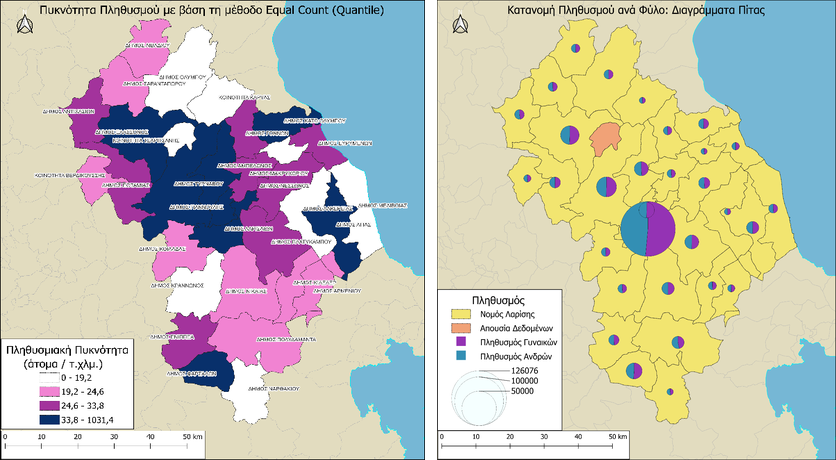
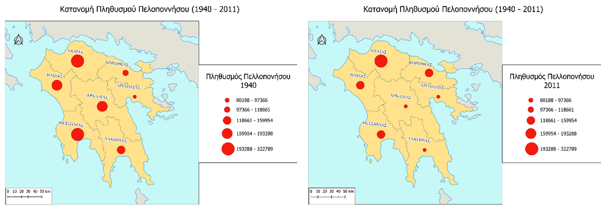
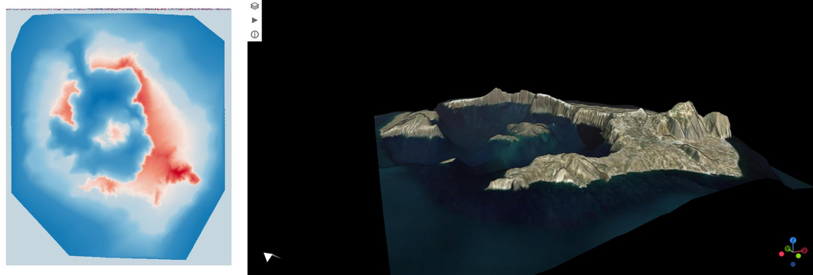
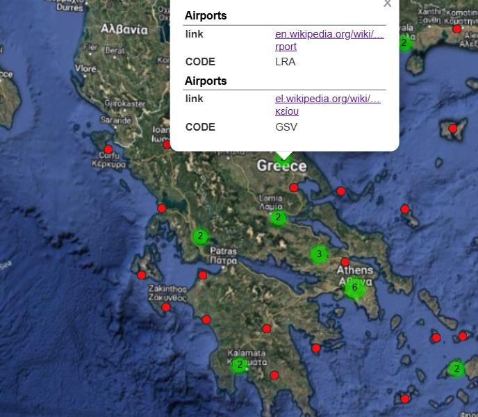
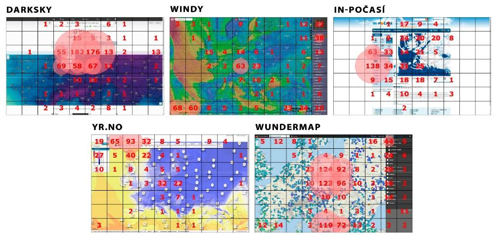

# Web GIS, Interactive Geovisualization & Cartographic Usability

Advanced cartographic workflows, 3D WebGL terrain visualization, spatiotemporal animation, and spatial User Experience (UX) evaluation developed for the postgraduate course *Cartographic Visualization*.

📄 **[Read the Full Technical Report & Presentation (PDF)](./Cartographic_Visualization_Web_GIS_Report.pdf)**

🌐 **Live demo:** [https://agathiba.github.io/web-gis-cartographic-visualization-usability/](https://agathiba.github.io/web-gis-cartographic-visualization-usability/)

| Map | Link |
| :--- | :--- |
| Animated population map of the Peloponnese (1940–2011) | [Open](https://agathiba.github.io/web-gis-cartographic-visualization-usability/) |
| 3D map of Santorini (desktop) | [Open](https://agathiba.github.io/web-gis-cartographic-visualization-usability/santorini/index.html) |
| 3D map of Santorini (mobile, with AR mode) | [Open](https://agathiba.github.io/web-gis-cartographic-visualization-usability/santorini/mobile.html) |
| Airports of Greece (interactive web map) | [Open](https://agathiba.github.io/web-gis-cartographic-visualization-usability/airports/index.html) |

---

## 📌 Project Modules

### 1. Static Cartographic Modeling & Spatial Distribution Analysis (QGIS)
* **Objective:** Methodological exploration of thematic cartography, measurement scales, and visual variables across the administrative units of Larissa Prefecture, Greece.
* **Methodology & Techniques:**
  * **Attribute & Spatial Classification:** Structured administrative vector layers; classified attributes across Nominal, Ordinal, Interval, and Ratio measurement scales.
  * **Statistical Breakdown (Histograms):** Compared **Natural Breaks (Jenks)** and **Quantile** classification algorithms on skewed population distributions to prevent visual distortion.
  * **Advanced Representation Methods:** Produced Choropleth maps, graduated point distributions, proportional pie charts (gender breakdown), and continuous area-distortion **Contiguous Cartograms** using the `cartogram3` algorithm.

<p align="center">
  
  <br><em>Choropleth population density (left) and proportional pie-chart symbols (right)</em>
</p>

<p align="center">
  
  <br><em>Frames from the animated population map of the Peloponnese, 1940 and 2011</em>
</p>

---

### 2. Interactive Web GIS & 3D Geovisualization Platform
* **Objective:** Development of an integrated web platform hosting interactive, temporal, and three-dimensional geospatial assets.
* **Interactive Modules:**
  * **Spatiotemporal Population Animation (Peloponnese 1940–2011):** Formulated a Python workflow ([`scripts/quantile_breaks.py`](./scripts/quantile_breaks.py)) utilizing `numpy.quantile` to standardize global symbology thresholds across all historical census records, producing smooth frame-blended temporal animations.
  * **3D Surface & Bathymetric Visualization (Santorini Island):** Fused sub-aerial Digital Elevation Models (DEM) with marine bathymetry rasters, serving interactive WebGL scenes with multi-source basemaps (Esri, Bing, Google) via `Qgis2threejs`.
  * **Interactive Web Map & Airport Geoportal:** Generated interactive vector mapping with spatial point clustering, search bars, and dynamic attribute popups via `qgis2web` (OpenLayers).
  * **Web Portal Deployment:** Compiled all assets into a unified, responsive HTML web interface.

<p align="center">
  
  <br><em>Santorini: bathymetry (left) and 3D terrain visualization from DEM data (right)</em>
</p>

<p align="center">
  
  <br><em>Multimedia web map of Greek airports with linked metadata</em>
</p>

---

### 3. Cartographic Usability & Eye-Tracking Evaluation
* **Objective:** Human-Computer Interaction (HCI) and usability analysis of web mapping interfaces based on eye-tracking research (Popelka et al., ISPRS).
* **Research & Analytical Scope:**
  * **Quantitative Eye-Tracking Metrics:** Evaluated gaze fixations, scanpath trajectories, trial duration, and visual heatmaps across 34 participants (16 novices vs. 18 GIS experts).
  * **Comparative Benchmark:** Analyzed usability bottlenecks, cognitive overload, and interface clarity across 5 web mapping platforms (*Windy*, *DarkSky*, *In-Počasí*, *YR.no*, *Wundermap*).
  * **User-Centered Design (UCD) Principles:** Synthesized guidelines for reducing visual clutter, optimizing legend accessibility, and designing adaptive user interfaces for diverse skill levels.

<p align="center">
  
  <br><em>Eye-tracking heatmaps on five weather web maps (Dark Sky, Windy, In-Počasí, Yr.no, Wundermap)</em>
</p>

---

## 🛠️ Tech Stack & Software
* **GIS & Web Mapping:** QGIS (`qgis2web`, `Qgis2threejs`, `cartogram3`, `QuickMapServices`), Leaflet / OpenLayers, WebGL
* **Programming & Data Analysis:** Python (NumPy, quantile distributions), HTML5/CSS
* **Graphics & Authoring:** GIMP, KompoZer
* **Domain Topics:** Thematic Cartography, 3D Bathymetry/DEM Fusion, Spatiotemporal Analysis, Cartographic UX/UI, Eye-Tracking Usability

---

## 📁 Repository Structure

```
├── docs/                         # Website, published with GitHub Pages
│   ├── index.html                # Landing page with all four maps
│   ├── peloponnese_animation.gif # Animated population map (1940–2011)
│   ├── santorini/                # 3D WebGL scene exported with Qgis2threejs
│   │   ├── index.html            #   desktop version
│   │   └── mobile.html           #   mobile version (device orientation & AR mode)
│   └── airports/                 # Interactive web map exported with qgis2web
├── scripts/
│   └── quantile_breaks.py        # Common quantile class limits for the animation
├── images/                       # Figures used in this README
└── Cartographic_Visualization_Web_GIS_Report.pdf
```

## ▶️ Run Locally

The maps load their data with JavaScript, so open them through a local web server rather than by double-clicking the files:

```bash
cd docs
python -m http.server 8000
# then open http://localhost:8000
```
